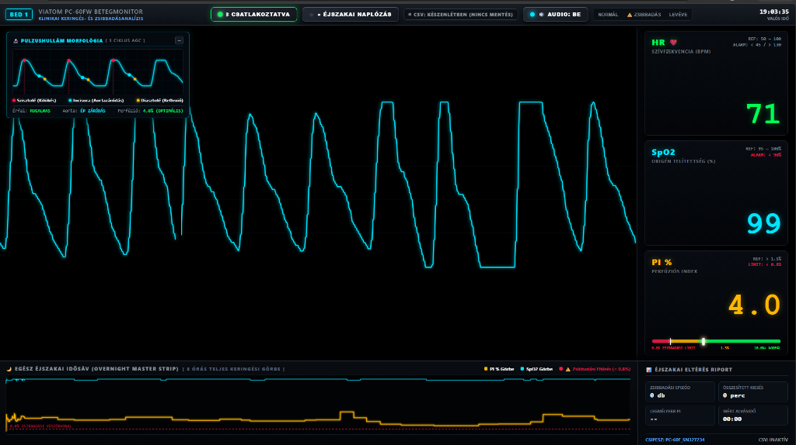

# Viatom PC-60FW Bedside ICU & Overnight Sleep Analysis Monitor

[](https://www.python.org/)
[](https://fastapi.tiangolo.com/)
[](https://websockets.readthedocs.io/)
[](https://github.com/hbldh/bleak)
[](https://microsoft.com)
[](LICENSE)
[](https://revolut.me/grezoo)

> **English documentation is followed by the Hungarian version below.**  
> *(A magyar nyelvű részletes leírás a dokumentáció második felében található.)*

---

<p align="center">
  
</p>

---

## 🇬🇧 Overview (English)

A hospital-grade, real-time bedside telemetry workstation, overnight sleep apnea analyzer, and peripheral microcirculation monitor engineered specifically for the **Viatom / Lepu PC-60FW** wireless Bluetooth pulse oximeter.

The system transforms a consumer medical sensor into a full-scale clinical telemetry station, featuring high-speed optical waveform rendering, real-time cardiac arrhythmia detection, AASM-standard oxygen desaturation indexing, and acoustic hypoperfusion warnings for sleep-induced numbness or vascular entrapment syndromes.

---

### 🌟 Key Clinical & Engineering Features

#### 1. 🫀 60 FPS Photoplethysmogram (PPG) Oscilloscope with Dynamic AGC
* **High-Speed Oscilloscope Wave**: Canvas-rendered arterial volume pulsation updated at **60 frames per second** with anti-aliasing and a luminous clinical glow.
* **Dynamic Automatic Gain Control (AGC)**: Real-time peak-to-peak amplitude tracker maintaining **35% adaptive headroom and footroom margins**. Eliminates signal clipping, flat saturated plateaus, and waveform loss during movement or physiological vasomotor changes.
* **Morphological Fidelity**: Crystal-clear representation of the systolic upstroke, percussion wave, dicrotic notch (aortic valve closure), and diastolic runoff.

#### 2. 🔍 3-Cycle Morphological Arrhythmia Magnifier HUD
* **Continuous Cycle Buffering**: Continuously analyzes consecutive pulse cycles and maintains a rolling baseline for cycle durations and peak intervals.
* **Automated Arrhythmia Detection**: Detects premature ventricular/atrial contractions (extrasystoles), compensatory pauses, bigeminy patterns, and sudden RR variability indicative of atrial fibrillation (AFib).
* **12-Second Interactive Freeze Latch**: Once an anomaly is detected, the HUD automatically latches and magnifies the 3 offending cardiac cycles with an amber countdown timer, while the master real-time monitor continues streaming unhindered.
* **Permanent Tabular Audit Log**: Every irregularity is recorded into a persistent on-screen session log with exact timestamp, cycle delta, and morphological classification.

#### 3. 🌙 Overnight Sleep Apnea Analyzer (AASM Criteria)
* **Oxygen Desaturation Index (ODI)**: Strictly implements American Academy of Sleep Medicine (AASM) criteria:
  * Relative drops of $\ge 3\%$ in arterial oxygen saturation ($\text{SpO}_2$) from rolling baseline, or
  * Absolute hypoxemic episodes where $\text{SpO}_2 < 91\%$.
* **Overnight Hypoxemia Metrics**: Calculates cumulative apnea episode counts, total desaturation time, hourly ODI index, and nadir (lowest) $\text{SpO}_2$.
* **Master Overnight Timeline Canvas**: Visualizes the entire monitoring session (up to 8+ hours) with cyan shading bands overlaying detected desaturation windows.

#### 4. ✋ Peripheral Microcirculation & Numbness Alert ($\text{PI} < 0.8\%$)
* **Perfusion Index (PI)**: Tracks the pulsatile vs. non-pulsatile arterial blood flow ($0.1\% - 20.0\%$).
* **Numbness & Compression Monitoring**: Specifically designed for evaluating nocturnal hand/arm numbness, thoracic outlet syndrome (TOS), carpal tunnel syndrome (CTS), and Raynaud's phenomenon.
* **Acoustic Warning Synthesizers (Web Audio API)**:
  * Soft harmonic pulse tone synchronized with live heartbeats.
  * Rapid warning beeps during severe peripheral hypoperfusion ($\text{PI} < 0.8\%$).
  * Continuous 980 Hz clinical flatline alarm upon optical signal loss / asystole.

#### 5. ⚡ Sub-Second Bluetooth Fast Reconnect (< 300 ms)
* Persistently caches the validated BLE MAC address to `device_cache.json`.
* Bypasses heavy Windows discovery scans, reconnecting in under **300 milliseconds**.
* Automated WinRT radio supervisor ensures the Windows Bluetooth radio is powered on (`RadioState.ON`).

#### 6. 🚀 Native Zero-Install Windows Executable (`Viatom_Monitor.exe`)
* 25 KB standalone C# Windows GUI launcher (`/target:winexe`).
* Suppresses black DOS / console terminal windows.
* Automatically launches the Python backend and opens your default browser at `http://localhost:8000`.
* Zero temporary folder unpacking delay; instant cold boot.

---

### 🏛 System Architecture

```text
[ Viatom PC-60FW Pulse Oximeter ]
              │ (Nordic UART Service BLE)
              ▼
[ Python Bleak / WinRT Radio Subsystem ]
              │
[ FastAPI Asynchronous Core (app.py) ]
       │                         │
       ├─► [ CSV Logger ]        ├─► [ WebSocket Telemetry Broadcaster ]
       │   (meresi_naplo.csv)    │   (ws://localhost:8000/ws)
                                 │
                                 ▼
                     [ HTML5 / Canvas Bedside UI ]
                     - 60 FPS PPG Waveform (Dynamic AGC)
                     - Arrhythmia Magnifier HUD (3-cycle freeze)
                     - Sleep Apnea ODI / Desaturation Engine
                     - Web Audio Medical Synthesizers
```

---

### 🚀 Quick Start (English)

#### Option 1: Native Windows Launcher (Recommended)
1. Clone or download this repository.
2. Double-click **`Viatom_Monitor.exe`**.
3. The launcher will automatically spin up the background telemetry service and open `http://localhost:8000` in your default browser.

#### Option 2: Run via Standard Python Environment
1. Clone this repository:
   ```bash
   git clone https://github.com/grezoo/viatom-pc60fw-monitor-PC.git
   cd viatom-pc60fw-monitor-PC
   ```
2. Install dependencies:
   ```bash
   pip install -r requirements.txt
   ```
3. Start the application:
   ```bash
   python app.py
   ```
4. Navigate to `http://localhost:8000` in your web browser.

---

### 📊 Telemetry Data & CSV Logging

All real-time measurements are logged second-by-second into `meresi_naplo.csv`:

| Column | Description | Valid Range |
| :--- | :--- | :--- |
| `Időbélyeg` | Local timestamp (`YYYY-MM-DD HH:MM:SS`) | ISO format |
| `SpO2 (%)` | Arterial blood oxygen saturation | $0 - 100\%$ |
| `Pulzus (bpm)` | Heart rate in beats per minute | $30 - 250\text{ bpm}$ |
| `PI (%)` | Peripheral Perfusion Index | $0.1 - 20.0\%$ |
| `Állapot` | Clinical state (`NORMÁL`, `ZSIBBADÁS`, `APNOÉ`, `LEVÉVE`) | Categorical |

---

### ☕ Support / Donate

If this open-source project assisted your sleep apnea research, circulation diagnostics, or engineering work, consider supporting development:

[](https://revolut.me/grezoo)

* **Revolut tag:** `@grezoo`
* **Direct link:** [https://revolut.me/grezoo](https://revolut.me/grezoo)

---

### ⚠️ Medical Disclaimer
*This software and hardware integration is intended solely for scientific research, engineering experimentation, and lifestyle observation. It is NOT an officially certified medical diagnostic device. For medical diagnosis, cardiac arrhythmias, or persistent sleep apnea symptoms, consult a qualified healthcare professional.*

---
---

## 🇭🇺 Magyar Nyelvű Dokumentáció

A **Viatom PC-60FW Bedside ICU & Overnight Sleep Analysis Monitor** egy professzionális, orvosi műszerfal minőségű telemetriás és adatgyűjtő rendszer a **Viatom / Lepu PC-60FW** vezeték nélküli Bluetooth pulzoximéterhez.

A szoftver objektív, másodperces és 60 Hz-es felbontású adatokkal vizsgálja a **perifériás mikrokeringést (Perfúziós Index - PI%)**, az **artériás véroxigén-telítettséget (SpO2)**, a **szívfrekvenciát (BPM)** és a **fotopletizmogram (PPG) pulzushullámot**.

---

### 🌟 Főbb Funkciók

1. **60 FPS PPG Oszcilloszkóp Dinamikus AGC-vel**:
   - Folyamatos, 60 képkocka/másodperces pulzushullám-rajzolás orvosi zöld és cián fénycsóvával.
   - **Dinamikus automatikus erősítésszabályozás (AGC)**: 35%-os alsó és felső mozgástérrel megakadályozza a hullámforma lelapulását (clipping) vagy telítődését kézmozdulat vagy érszűkület esetén.
   - Kristálytisztán kivehető a szisztolés csúcs, az incisura (aortabillentyű záródás) és a diasztolés visszaverődés.

2. **3-Ciklusos Morfológiai és Aritmia Nagyító HUD**:
   - Valós időben puffereli az egymást követő szívveréseket.
   - Automatikusan észleli a korai ütéseket (extrasystole), a kompenzációs szüneteket, a bigeminiát és a pitvarfibrillációra (AFib) utaló hirtelen ritmusvariabilitást.
   - **12 másodperces reteszelés**: Eltérés észlelésekor kimerevíti és 3-szorosára nagyítja a kritikus 3 ciklust egy borostyán színű visszaszámlálóval, miközben a háttérben a valós idejű monitorozás zavartalanul fut.
   - **Permanens eseménynapló**: Minden észlelt anomália bekerül az alsó eseménylistába pontos időbélyeggel és eltérési értékkel.

3. **Egész Éjszakai Alvási Apnoé Elemző (AASM Szabvány)**:
   - Az American Academy of Sleep Medicine (AASM) klinikai kritériumai szerint számítja az **Oxigén Deszaturációs Indexet (ODI)**:
     - Gördülő bázisvonalhoz képest $\ge 3\%$-os oxigénszint-esés, vagy
     - $91\%$ alatti abszolút oxigéntelítettség ($\text{SpO}_2 < 91\%$).
   - Kiszámítja az összesített kiesési időt, a legmélyebb oxigénszintet és az óránkénti apnoé indexet.
   - Teljes éjszakai (akár 8+ órás) idővonal cián színű esemény-sávokkal.

4. **Perifériás Zsibbadás és Keringési Figyelmeztetés ($\text{PI} < 0.8\%$)**:
   - Speciálisan a kézzsibbadás, alagút szindróma (CTS), mellkaskimeneti szindróma (TOS) és Raynaud-szindróma objektív mérésére fejlesztve.
   - Keringési hangjelzések (Web Audio API): szívveréssel szinkron halk tónus, zsibbadáskor sürgető figyelmeztetés, ujj levétele vagy aszisztólia esetén 980 Hz-es folyamatos sípolás.

5. **Azonnali Bluetooth Újracsatlakozás (< 300 ms)**:
   - A sikeresen párosított eszköz MAC címét lemezre menti (`device_cache.json`).
   - Nem igényel lassú operációs rendszeri keresést; 300 ms alatt újracsatlakozik.
   - Automatikusan bekapcsolja a Windows Bluetooth rádiót, ha az inaktív lenne.

6. **Natív Windows Futtató (`Viatom_Monitor.exe`)**:
   - 25 KB méretű, C# nyelven fordított natív Windows GUI alkalmazás.
   - Nem nyit fekete parancssori ablakot, a háttérben indítja a mérőszervert és automatikusan megnyitja a böngészőt (`http://localhost:8000`).

---

### 🚀 Gyors Indítás (Magyar)

1. Töltse le vagy klónozza ezt a repót.
2. Kattintson duplán a **`Viatom_Monitor.exe`** fájlra.
3. Helyezze a mérőcsipeszt az ujjára. A monitor másodperceken belül megjeleníti az élő keringési adatokat a böngészőben.

---

### ☕ Fejlesztői Támogatás / Revolut

Ha a projekt segített az alvási apnoé, éjszakai zsibbadás feltárásában vagy a keringésed monitorozásában, meghívhatsz egy kávéra:

[](https://revolut.me/grezoo)

* **Revolut azonosító:** `@grezoo`
* **Közvetlen link:** [https://revolut.me/grezoo](https://revolut.me/grezoo)
